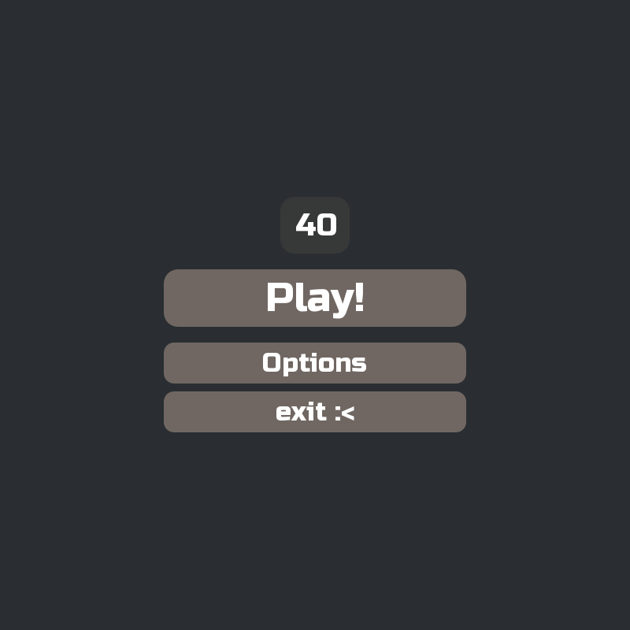

#  QtSudoku
Hi! It's my first project on QML and QtWidgets.

# Demo

Regenerate the animated demo from the current QML interface (Python 3 and Pillow
are required in addition to the application's Qt 6 Quick dependencies):

```sh
python3 -m venv build/media-venv
build/media-venv/bin/pip install Pillow
cmake -S . -B build -DSUDOKU_MEDIA_PYTHON="$PWD/build/media-venv/bin/python3"
cmake --build build --target screenshots
```

After setup, only the last command is needed. It replaces `screenshots/demo.gif`
with a looping demo: menu, entering digits, Help highlighting a mistake, completing
the puzzle, and victory confetti. It uses Qt's offscreen platform and software
renderer, so no desktop session or external screenshot utility is needed.
The animation is 800×800 without window borders. The puzzle is generated afresh
on each run, and no game history is written. Temporary frames are removed automatically.



# License
This project is licensed under the MIT License - see the [LICENSE](LICENSE) file for details.

# Credits
I am grateful to:
- Andrey Qantum for the icon and application design
- [MeldStudio](https://github.com/MeldStudio) for the open source code of [canvas-confetti-qml](https://github.com/MeldStudio/canvas-confetti-qml) and a wonderful  realizaiton

# TODO
- Options page with graphic setting, such as a color theme, fonts.
- About page with information about authors, version, qt version.
- Timer. This is regression.
- Normal leader board, without simple txt file.
